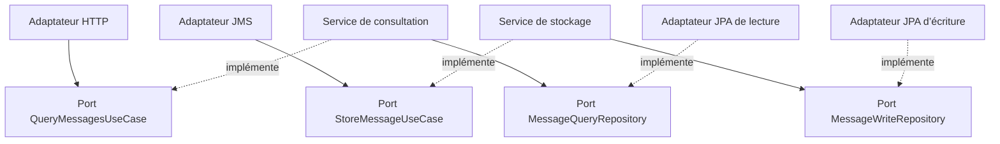
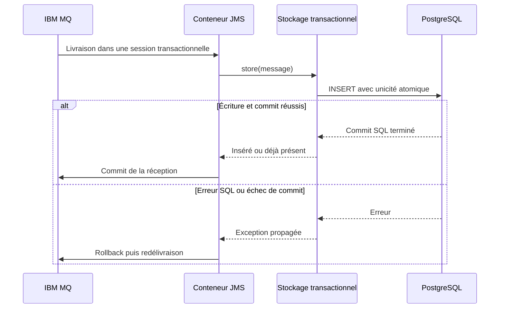

# Architecture de l’application

## Vue d’ensemble

BANK Messaging associe un backend Spring Boot, un frontend Angular et deux dépendances persistantes : IBM MQ et PostgreSQL. Le backend est un monolithe modulaire structuré par fonctionnalités : `ingestion` et `consultation`. Une même base est utilisée par les deux fonctionnalités, sans duplication du stockage.

En développement, Angular et Java tournent sur l’hôte et les dépendances dans Compose. En déploiement applicatif, Nginx sert le build Angular et relaie REST, Swagger et la santé globale vers Java sur le réseau Docker. Seul le port web est publié pour les conteneurs applicatifs ; les ports techniques SQL/MQ restent exposés sur loopback par la configuration d’infrastructure.

## Architecture hexagonale du backend

Le noyau applicatif contient les cas d’utilisation, les interfaces de ports, les projections et les exceptions applicatives. Il dépend uniquement du JDK. HTTP, JMS, JPA, Spring, les transactions et les métriques appartiennent à la périphérie.

| Responsabilité | Consultation | Ingestion |
|---|---|---|
| Adaptateur entrant | `MessageController` | `JmsMessageListener` |
| Port d’entrée | `QueryMessagesUseCase` | `StoreMessageUseCase` |
| Service applicatif | `MessageQueryService` | `MessageStorageService` |
| Port de persistance | `MessageQueryRepository` | `MessageWriteRepository` |
| Adaptateur de persistance | `JpaMessageQueryRepository` | `JpaMessageWriteRepository` |
| Décorateur transactionnel | `TransactionalMessageQuery` | `TransactionalMessageStorage` |
| Modèles | `MessageFilter`, `MessageSummary`, `MessageDetails`, `MessagePage` | `ReceivedTextMessage` |

Les adaptateurs entrants dépendent des ports d’entrée et les adaptateurs sortants implémentent les ports définis par l’application. Les services ignorent les contrôleurs, les objets JMS et l’entité SQL. L’inversion des dépendances permet de vérifier leur logique avec des doubles ciblés.

Ce diagramme exprime les dépendances de code. À l’exécution, les services sont enveloppés par les décorateurs transactionnels avant leur injection dans HTTP/JMS.

## Assemblage et organisation

Le package racine est `com.bank.messaging`.

| Package | Contenu et règles |
|---|---|
| `config` | `UseCaseConfiguration`, point d’assemblage des cas d’utilisation |
| `consultation.application` | Ports, validation des requêtes, projections et exceptions ; aucun framework |
| `consultation.api` | Conversion des paramètres HTTP, réponses JSON et Problem Details |
| `consultation.infrastructure` | Requêtes Criteria JPA et frontière transactionnelle de lecture |
| `ingestion.application` | Port d’entrée, port d’écriture et service de stockage ; aucun framework |
| `ingestion.messaging` | Adaptation JMS, validation du transport, redélivraison et backout |
| `ingestion.config` | Propriétés validées et conteneur de consommation JMS |
| `ingestion.infrastructure` | Insertion SQL instrumentée et frontière transactionnelle d’écriture |
| `persistence` | Entité interne et repository Spring Data partagés par les adaptateurs |

`UseCaseConfiguration` construit les services puis leurs décorateurs. Seuls les ports décorés sont exposés comme beans applicatifs ; les services nus ne sont pas enregistrés. Les dépendances sont injectées par constructeur. Le monolithe reste un seul module Maven : aucune isolation de packages par le système de modules Java n’est revendiquée.

Aucun domaine bancaire n’est inventé pour un besoin de conservation brute. Les records applicatifs sont distincts de l’entité JPA et n’importent ni annotations de sérialisation ni annotations Swagger. Le contrat HTTP utilise ces projections sans ajouter un mapping identique sans responsabilité propre.

## Flux d’ingestion et transactions

`TransactionalMessageStorage` utilise un `TransactionTemplate` avec propagation `REQUIRES_NEW` et délai de 10 secondes. La transaction SQL se termine avant le retour au conteneur JMS, même lorsqu’un appelant possède déjà une transaction SQL. Un tel appel imbriqué peut nécessiter une connexion supplémentaire ; le listener courant n’ouvre pas de transaction SQL englobante.

SQL et MQ ne partagent pas de transaction distribuée. Si le processus s’arrête entre leurs commits, MQ peut redélivrer un message déjà stocké. La contrainte unique et `ON CONFLICT` rendent ce nouveau passage sans insertion supplémentaire. Les détails du backout et des erreurs sont dans [INGESTION.md](INGESTION.md).

## Flux de consultation

Le contrôleur traduit HTTP en paramètres applicatifs. Le service valide les bornes, appelle le port de lecture et calcule l’enveloppe de pagination. L’adaptateur Criteria n’ajoute que les prédicats actifs, avec paramètres et tri restreint à date/ID. La liste projette uniquement les métadonnées ; le détail récupère aussi le texte.

La page utilise une transaction en lecture seule `REPEATABLE_READ`, délai 10 secondes, afin que le comptage et les lignes partagent un instantané PostgreSQL. Le détail utilise une transaction distincte en lecture seule. La propagation est `REQUIRED` : une transaction SQL appelante existante imposerait son isolation ; l’entrée HTTP actuelle n’en ouvre pas.

L’isolation d’une page ne fige pas les requêtes suivantes. Des insertions entre deux pages peuvent décaler une pagination par offset. Les bornes et le tri stable sont décrits dans [API.md](API.md).

## Persistance

Flyway est propriétaire des migrations ; Hibernate valide le schéma et ne le crée pas. L’entité `ReceivedMessageEntity` est un modèle de lecture immutable. L’écriture passe par une requête PostgreSQL native ciblée, évitant le scénario « vérifier puis insérer » et le traitement d’un doublon dans une transaction déjà rollback-only. `open-in-view` est désactivé.

Le schéma et le coût des index sont détaillés dans [DONNEES.md](DONNEES.md).

## Frontend et documentation HTTP

Angular charge la fonctionnalité messages et ses pages à la demande. Les composants standalone utilisent `OnPush`, des signaux pour l’affichage et RxJS pour les changements de route et les requêtes. L’URL est la source de vérité de la recherche ; `switchMap` annule les requêtes obsolètes. Un état discriminé exprime chargement, succès, absence et erreur, avec délai HTTP de 15 secondes.

Swagger UI est servi par Springdoc et consomme le fichier OpenAPI maintenu. La génération d’un second document inféré est désactivée ; aucun framework de documentation ne pénètre dans les cas d’utilisation. Voir [API.md](API.md) et [IHM.md](IHM.md).

## Contrôles de structure

`ApplicationBoundaryTest` compile tous les fichiers des packages `application` avec le seul JDK 21 et des classpath/sourcepath vides. Une dépendance directe vers Spring, JMS, JPA ou un adaptateur fait échouer ce test. Le test ne détecte pas un accès réflexif construit par chaînes de caractères. `UseCaseConfigurationTest` vérifie l’assemblage et les options transactionnelles sans infrastructure ; les garanties durables exigent les tests réels MQ/PostgreSQL.
