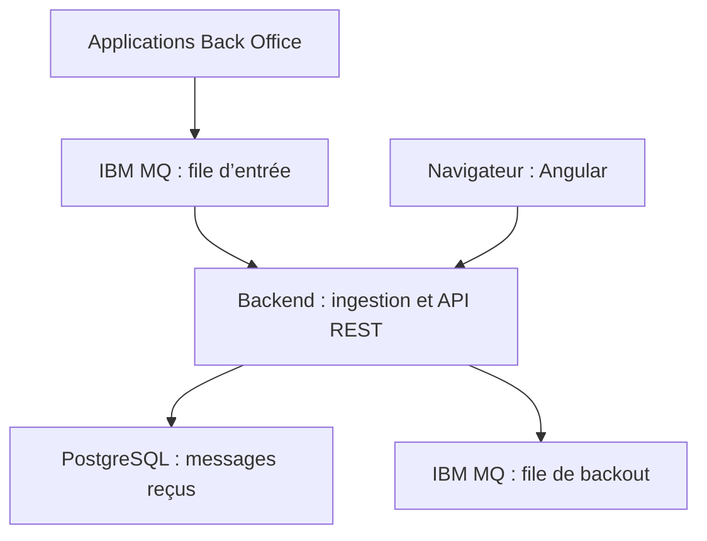

# Documentation de BANK Messaging

Cette documentation décrit l’application et sa configuration livrée. Les commandes supposent les valeurs par défaut ; les ports, files et identifiants modifiés doivent être reportés dans les exemples.

## Parcours de lecture

| Document | Contenu |
|---|---|
| [Périmètre](SPECIFICATION.md) | Objectifs fonctionnels, limites et critères d’acceptation |
| [Installation et configuration](ENVIRONNEMENT.md) | Versions, prérequis, démarrage, variables et ports |
| [Architecture](ARCHITECTURE.md) | Composants, architecture hexagonale, dépendances et transactions |
| [Décisions techniques](DECISIONS.md) | Raisons des choix, compromis et alternatives |
| [Modèle de données](DONNEES.md) | Schéma, identité, migrations, index et cycle de vie |
| [Ingestion et résilience](INGESTION.md) | Validation JMS, commits, doublons, redélivraison et backout |
| [API et Swagger UI](API.md) | Routes, paramètres, modèles, erreurs et essais HTTP |
| [Guide utilisateur et frontend](IHM.md) | Parcours, recherche, pagination, états et structure Angular |
| [Exploitation](EXPLOITATION.md) | Santé, métriques, logs, files, diagnostic et sauvegardes |
| [Tests et validation](TESTS.md) | Suites, commandes, couverture et limites des preuves |
| [Performance](PERFORMANCE.md) | Protocole de charge, résultats conservés et interprétation |
| [Construction et livraison](LIVRAISON.md) | Artefacts, Docker, CI et archive locale |

Les configurations de référence sont [application.yaml](../backend/src/main/resources/application.yaml), [.env.example](../.env.example), [compose.yaml](../compose.yaml) et [compose.app.yaml](../compose.app.yaml). Le contrat consommable par les outils est [openapi.json](../backend/src/main/resources/static/openapi.json).

## Vue fonctionnelle

Le stockage conserve le texte du message et ses métadonnées sans interprétation métier bancaire. La file d’entrée est un tampon durable lorsque les producteurs envoient des messages persistants. La file de backout isole les formats non acceptés. L’interface web ne consulte que les messages enregistrés en base ; elle ne parcourt pas les files MQ.

## Conventions

Les dates API sont des instants ISO-8601 avec fuseau et sont affichées en UTC dans l’interface. Une page API commence à zéro ; la page affichée commence à un. La taille du payload est exprimée en octets UTF-8. Les exemples utilisent exclusivement des contenus synthétiques. Les rapports de performance sont datés et ne décrivent pas une capacité garantie.

Les données structurées sous `performance/` sont des preuves historiques. Le [guide de tests](TESTS.md) distingue leur état de la validation du code courant.
